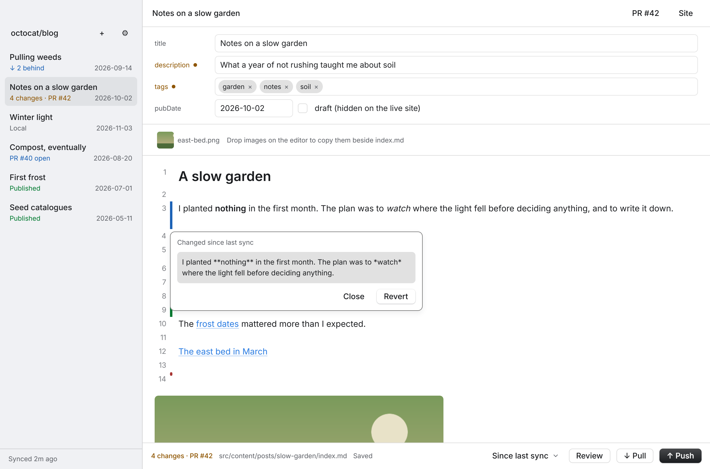
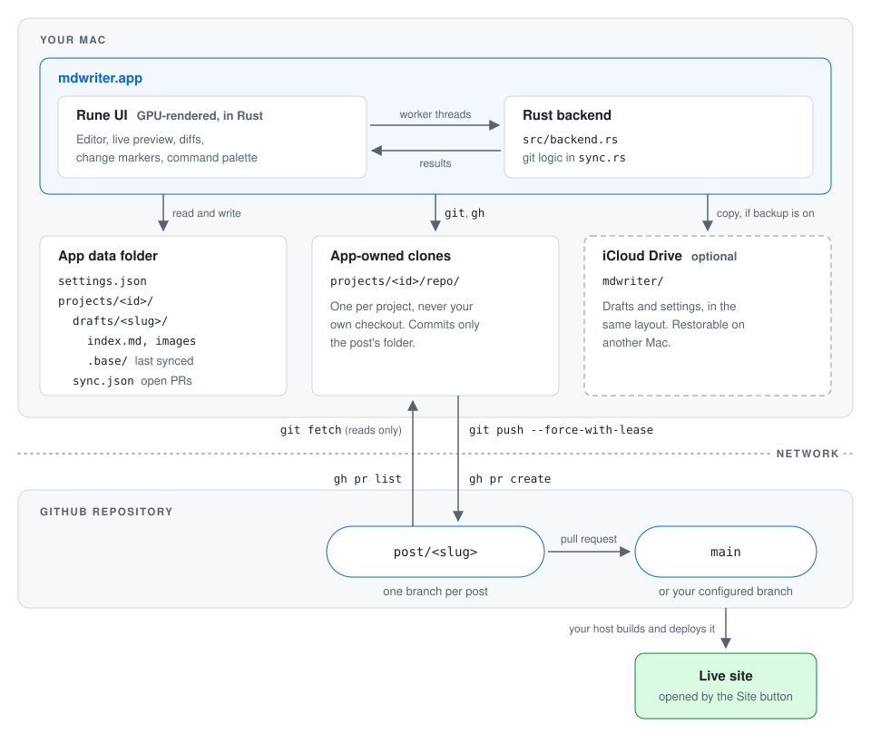

# mdwriter

A macOS writing app for Markdown posts that live in a git repository. You write in a focused editor, and each post goes to the repository as its own branch and pull request. Nothing is published until that PR is merged.

It's built for people who already run their site from a git repository, with a branch that deploys and pull requests as the way changes get in. [Astro](https://astro.build) content collections are a first-class target, but any repository that keeps posts as Markdown files in one folder works.

Built in Rust with [Rune](https://github.com/anomalyco/rune), a GPU-rendered UI framework. There is no webview: the app draws its own window, and the git and GitHub logic runs in the same process.



*A draft in live preview, with change markers since the last sync: a changed line in blue, an added line in green, the changed `description` and `tags` fields marked, and a marker's popup showing the old text with Revert.*

## Architecture

Everything you write stays on your Mac until you choose an action. The app works in its own clone of your repository, never in your checkout, and only talks to the remote through `git` and the GitHub CLI.



Three rules keep local and remote from overwriting each other:

- **Reads are automatic, writes are explicit.** Opening the app lists posts from local state at once, then a background `git fetch` and `gh pr list` refresh the counts. Drafts and the remote only change when you pick Pull, Push or Open PR.
- **Upstream is the source of truth.** Each draft remembers the remote version it last matched (`.base/`). Push refuses while the remote has changes you haven't pulled, and pushes with `--force-with-lease`, so GitHub also refuses it if the branch moved after the last fetch.
- **Pull never overwrites your work.** Remote changes merge into the draft. If they clash with yours, the draft stays untouched until you resolve the conflict in a side-by-side view.

## Requirements

- macOS. Linux builds through Nix too (below), but iCloud backup is macOS only.
- Rust, to build it. `.tool-versions` pins the version for [mise](https://mise.jdx.dev): run `mise install`. On Linux the build also needs `libxkbcommon-dev`, `libwayland-dev` and `libfontconfig1-dev` (Debian names), and a Vulkan driver to run.
- `git` with SSH access to your repository on GitHub
- The GitHub CLI, `gh`, logged in

## Run

```sh
mise install          # Rust at the pinned version
cargo run            # development build
cargo test           # the git, frontmatter, keymap and editor tests
scripts/release.sh   # builds mdwriter.app, installs it to /Applications, and restarts mdwriter if it was open
```

Rune is pre-release, so `Cargo.toml` pins one commit of its `dev` branch. It has no bundler: `scripts/release.sh` assembles `mdwriter.app` from the release binary, the icon and an `Info.plist`, and signs it ad hoc.

### Headless rendering

Rune can draw the app without a window, which is how the UI is checked in CI or a container. `src/demo.rs` defines fixture scenes (`editor`, `source`, `markers`, `palette`, `readonly`, `setup`, `settings`, `review`, `conflict`) that never touch your data or the network:

```sh
cargo run -- --snap out.png --scene markers --size 1100x720 --theme dark
cargo run -- --script input.json --snap out.png --tree out.json --at 2 --scene editor
```

`--script` replays taps, keys and typed text from a JSON file, and `--tree` dumps the element tree. Without a GPU, install a software Vulkan driver (`mesa-vulkan-drivers`). Set `MDWRITER_DATA_DIR` to run the real app against a different data folder.

### NixOS

`devenv.nix` is a development shell for x86_64 Linux with the Wayland, X11 and Vulkan libraries Rune loads: run `devenv shell`, then `cargo run`.

`flake.nix` packages the app for x86_64-linux:

```sh
nix run github:richard-parayno/mdwriter
nix profile install github:richard-parayno/mdwriter
```

In a NixOS configuration, add the flake as an input, then use its overlay:

```nix
nixpkgs.overlays = [ mdwriter.overlays.default ];
environment.systemPackages = [ pkgs.mdwriter ];
```

The package puts `git`, `gh`, `curl` and `openssh` on the app's `PATH`. Rune is fetched as a git dependency at the commit in `Cargo.lock`.

## Setup

On first launch, mdwriter asks for these in two steps. You can change them later in Settings.

- **GitHub repository**, as `owner/name`. mdwriter clones it into its own folder.
- **Branch**: the branch posts are read from and pull requests target, usually `main`.
- **Posts folder**: where posts live in the repository, such as `src/content/posts`.
- **Post URL**: the live URL of a post, with `{slug}` in place of the slug. For an Astro project, **Detect site** works it out for you (see below).

Continue checks that the repository and branch are reachable before saving. If you turned on iCloud backup on another Mac, the first screen offers to restore those projects and settings instead. Settings are saved in `~/Library/Application Support/com.richardparayno.mdwriter/settings.json`.

## Projects

Each repository you write for is a project, with its own clone, drafts and settings above. Click the project name at the top of the sidebar, or press ⌘O, to switch between them or add another. The window shows one project at a time, and only that one fetches from GitHub.

**Archive**, in Settings, takes a project out of the switcher. Its clone and drafts stay on your Mac, including unpushed changes, and **Unarchive** in Settings brings it back as it was. You can add the same repository twice with different branches.

## Keyboard shortcuts

| Action | Default |
| --- | --- |
| Command palette: every action and post | ⌘K |
| Switch project | ⌘O |
| New post | ⌘N |
| Sync with GitHub (fetch only; drafts never change) | ⌘R |
| Settings | ⌘, |
| Pull | ⌘⇧L |
| Push | ⌘⇧P |
| Open PR | none |
| Review changes | none |
| Toggle change markers | ⌘⇧D |

To change one, open **Settings › Keyboard shortcuts**, click its shortcut and press the new keys. Backspace removes a shortcut and Escape cancels. The reset button beside a changed shortcut restores its default.

A shortcut needs ⌘ or ⌃ (or an F key), so it can't catch ordinary typing. Two actions can't share one. ⌘Q, ⌘W, ⌘H, ⌘M and the editing shortcuts (⌘A, ⌘C, ⌘V, ⌘X, ⌘Z, ⌘⇧Z) stay reserved. Changes are saved in `settings.json` under `keybinds`, and only the ones that differ from the defaults are stored. The actions and defaults are defined in `src/keymap.rs`.

## Astro support

- **Detect site** reads `site`, `base`, `trailingSlash` and `build.format` from `astro.config`, finds the collection that loads your posts folder in the content config, and finds the page in `src/pages` that renders it. It then requests one published post to check the URL.
- **Post IDs** match Astro's glob loader: `posts/foo/index.md` and `posts/foo.md` are both the post `foo`.
- **Frontmatter** gets its own fields for `title`, `description`, `pubDate`, `tags` and `draft`. Other frontmatter keys are kept as they are.
- **`draft: true`** posts are labelled Hidden, and the Site button is hidden for them, since Astro sites usually leave drafts out of the build.

Outside Astro, set the Post URL by hand. The frontmatter fields above are still what the editor shows.

## How it works

- **Drafts** live in `~/Library/Application Support/com.richardparayno.mdwriter/projects/<id>/drafts/<slug>/index.md`, with dropped images copied beside them and referenced as `./name.png`. They save automatically as you type, through a temporary file so a crash can't truncate them, and ⌘Q saves any pending edit before quitting.
- **Each post is a branch, `post/<slug>`.** A draft keeps a hidden `.base/` copy of the files as they last matched the remote, plus `.mdwriter.json` with that commit.
- **Pull** fetches, then merges remote changes into the draft. Without clashes, they merge in and **Undo** restores the exact draft. With clashes, a side-by-side view opens: the left side (yours, with the clean remote changes already merged in) becomes the draft on **Resolve**. **Abort** drops the pull.
- **Push** commits only the post's folder to `post/<slug>` and pushes it. Single-file posts stay single files until they get images.
- **Open PR** opens a pull request from `post/<slug>` into your branch, as its own step. Once the PR is merged, the draft tracks your branch again.
- **Edit** starts a draft from a post that's already on your branch.
- **Review changes** shows the remote against your draft: what Push would send. **Change markers** (the picker in the footer) mark lines added, changed or removed since the last sync, since your branch, or since any commit of the post. Click a marker to see the old text and revert it.
- **Backup**, when on, copies each draft and the settings to `iCloud Drive/mdwriter` as they save, in the same `projects/<id>/` layout. It never deletes anything there.

## Security

mdwriter treats the repository and the iCloud backup as untrusted input:

- Clones check out symbolic links as plain files (`core.symlinks=false`), and Push, Pull and backup refuse to read or write through a link. A post can't make the app write outside its own folders.
- Slugs, project ids, branches, revisions and folders are checked before they reach `git`. Detect site accepts only an `http(s)` `site` and passes it to `curl` with `--url` and `--proto =http,https`.
- There is no webview and nothing in a post is executed: Markdown is drawn as styled text. Image previews load only files beside the draft, never a URL or a path outside its folder.
- Links open only `http`, `https` and `mailto` URLs.

The git logic is in `src/sync.rs`. Its tests run each guarantee against a local bare repository: `cargo test`.

## Editor notes

The editor is one Rune text field holding the post's Markdown. Live preview restyles it instead of replacing it: `src/md.rs` finds the syntax (`**`, `#`, link URLs), and those characters are drawn at near-zero size except on the line with the caret. Rune's text decorations can't insert widgets into text, so an image on its own line is previewed below the text with its line number rather than inline. Rune lays the whole field out again on each keystroke, so typing gets slower in very long posts (Rune's own notes measure about 12 ms per key at 50 KB).

## License

[MIT](LICENSE)
